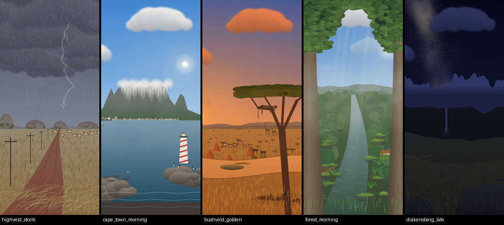

# SA Live Weather — Android live wallpaper

An animated Android live wallpaper with five South African scenes. Each one runs through a full 24-hour weather cycle with real moon phases, a southern-hemisphere sky and ambient wildlife.



| Scene | Hero moment | Wildlife |
|---|---|---|
| **Highveld Thunderstorm** (Gauteng) | Afternoon storm with fork lightning, rain and wind-bent grass | Prowling lion, pronking springbok herd, snake crossing the dirt road, secretary bird, circling vultures, lightning bugs |
| **Cape Town Atlantic Seaboard** | Morning tablecloth pouring over Table Mountain | Breaching southern right whale, dolphins, seals (flop into the sea), penguins, diving gannets, passing ships |
| **Kruger Bushveld** | Golden-hour silhouettes and red dust | Elephant herd crossing the riverbed at dawn, leopard on an acacia branch, crocodile, giraffe, resting lion pride (one yawns), hornbills, impala, kudu, a rare cheetah sprint, eyes glowing at night |
| **Garden Route Forest** | Soft misty drizzle, light shafts in the morning | Boomslang, Knysna loerie with crimson flash, monitor lizard, bushbuck, tree frogs, fireflies, glowing fungi |
| **Drakensberg** | Snow storm, then the darkest sky with the Milky Way | Bearded vulture, mountain leopard, eland herd, puff adder; fresh snow and a waterfall that freezes and swells |

## Features

- **Shared cycle engine:** dawn → morning → midday → storm build → storm peak → clearing → golden hour → dusk → night → late night. Lighting, clouds, rain, wind, mist and wildlife behaviour are all derived from one continuous atmosphere model (`engine/Atmosphere.kt`).
- **Time:** real device time, a demo mode (1×–120×, where 1× is already a full day every 24 minutes), or a fixed manual time.
- **Celestial layer:**
  - Accurate lunar phase from the 2000-01-06 new-moon epoch, lit on the correct side for the southern hemisphere, with a realistic rise time and arc.
  - Moon glow that lights the scene.
  - Twinkling star field with per-scene density and light pollution.
  - A Milky Way band that appears only on dark, moon-poor nights at dark-sky sites.
  - Shooting stars, the Southern Cross with its Pointers, Scorpius, Orion (upside down, as seen from the south), and Venus, Jupiter and Saturn.
- **Weather:** rain, drizzle and snow particles; fork, sheet and distant heat lightning with flash lighting; a storm front that rolls in from the east; dust devils; fog banks; steam after rain; rainbows; heat shimmer; spray, falling leaves, fireflies and bioluminescent surf.
- **Eight themes:** Authentic, Golden Africa, Moody Cape, Vivid, Noir (monochrome with a single warm accent, on Android 10+), Infrared, Sunset Always, and Dark Mode.
- **Parallax:** from launcher scrolling and the gravity sensor, plus a subtle continuous drift.
- **Performance presets:** High (60 fps), Balanced (30 fps), and Battery saver (20 fps, fewer particles, no parallax). Rendering pauses whenever the wallpaper isn't visible.
- **Scene switching:** double-tap the home screen to change scene, or let scenes rotate every 4 hours.

Audio from the brief isn't implemented yet.

## Using the app

Open **SA Live Weather** from the launcher to get a full-screen live preview. From there you can:

- Pick a scene.
- Scrub through the day with the time slider, or run the demo cycle.
- Tap **Set as live wallpaper**.

All settings are also available from the system wallpaper picker's *Settings* button.

## Building

Requirements: JDK 17 and the Android SDK (compileSdk 35).

```bash
./gradlew assembleDebug        # app/build/outputs/apk/debug/app-debug.apk
./gradlew assembleRelease      # minified, signed with the debug key for side-loading
```

Every push runs the **Build APK** GitHub Actions workflow, which uploads both APKs as the `sa-weather-lwp-apks` artifact. For a Play Store release, replace the debug signing config in `app/build.gradle.kts` with a real keystore.

## Architecture

Everything is drawn procedurally with `android.graphics` (no bitmaps or third-party libraries). Static landscape strips are rendered once per screen size and tinted each frame through a `LightingColorFilter`. Animals and weather are drawn live from paths.

```
WeatherWallpaperService / ui.PreviewActivity
        └── engine.SurfaceDriver      render thread, frame pacing, hardware canvas
              └── engine.Renderer     clock, parallax, theme grade, layer stack:
                    1  Sky            gradient, sun glow, light pollution
                       Celestial      stars, Milky Way, constellations, planets, meteors, moon, sun
                    3  Weather        clouds, storm front, lightning
                    2,4,5 Scene       landscape layers + wildlife actors (scenes/*Scene.kt)
                    3  Weather        dust, spray, leaves, fireflies, rain / drizzle / snow
                    6  Scene          foreground (grass, foam, trunks)
                    7  Weather        fog, haze, heat shimmer, rainbow, lightning flash
                       Scene          emissive lights (lighthouse, city, fungi)
                    8  Overlay        optional time / scene name
```

- `scenes/Scene.kt`: base class, layer pre-rendering, and landscape helpers.
- `scenes/Actor.kt` and `scenes/Walker.kt`: wildlife behaviour. Activity windows control when an animal appears; when a storm builds, animals flee or hide; walking animals and herds cross the scene.
- `engine/Wildlife.kt`: a parametric quadruped rig plus bird and snake drawers, shared by all scenes.
- `engine/Theme.kt`: colour-matrix grades and the per-theme knobs (bloom, fog density, silhouettes, rain and lightning tint).
